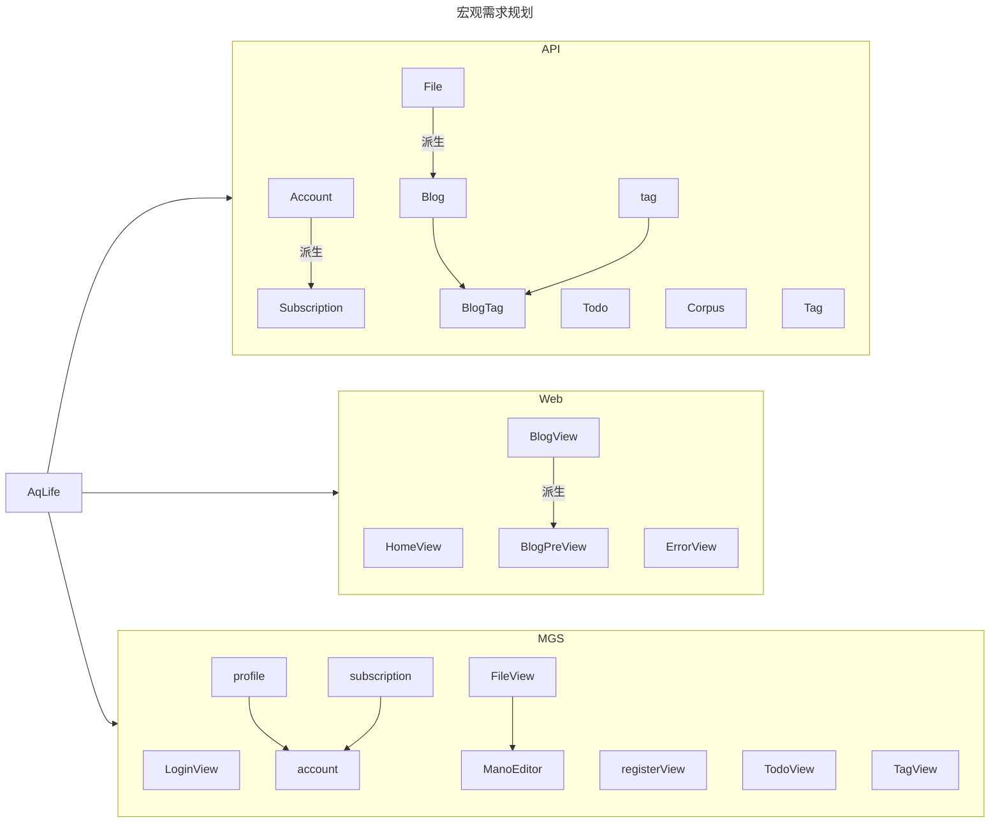

# 项目结构

## 如何运行该项目

项目依赖:

- Node v24+
- NET 8
- PostgreSQL 18.X

```shell
## 从0开始
## 第一步创建一个数据库,并同步创建一个程序账户,完成授权
CREATE DATABASE aqlife;-- 此时数据库名称对应 NET 数据库连接字符串,也可以修改,参照 appsettings.Development.example.json

## 第二步 创建你自己的程序配置文件
cp services/API/Web/Configurations/appsettings.Development.example.json services/API/Web/Configurations/appsettings.Development.json
## ! 请编辑这个文件,添加你的数据库链接字符串,JWT[可选]


## 第三步完成 CodeFrist 生成,将数据模型迁移至 PostgreSQL 数据库
dotnet ef database update --project .\services\API\PostgreSqlMigrations\PostgreSqlMigrations.csproj --startup-project .\services\API\Web\Web.csproj
## 这里是示例,请根据实际部署路径修改

## 开发环境协议选择（HTTP 默认，HTTPS 可选）

API、Web 和 MGS 每次启动只监听一种协议，不会同时打开 HTTP 与 HTTPS。默认使用 HTTP，不需要证书；需要 HTTPS 时，在启动命令后显式选择 `:https`。HTTP 与 HTTPS 使用相同端口，仅协议不同：

| 服务 | HTTP（默认） | HTTPS（可选） |
|---|---|---|
| API / Swagger | http://localhost:5110/swagger | https://localhost:5110/swagger |
| Web | http://localhost:5173 | https://localhost:5173 |
| MGS | http://localhost:5200 | https://localhost:5200 |

服务监听 `0.0.0.0`，可供本机和局域网设备访问。局域网访问时，请将 `localhost` 替换为运行服务电脑的局域网 IP 或证书中包含的 DNS 名称。HTTPS 证书必须包含这些访问名称/IP 的 Subject Alternative Name（SAN）。

### 1. HTTP 默认启动

在仓库根目录分别启动需要的服务：

```shell
npm run dev:api
npm run dev:web
npm run dev:mgs
```

### 2. HTTPS 证书生成（Ubuntu / Windows / macOS）

开发 HTTPS 使用 mkcert 创建本地开发 CA 和服务端证书。mkcert 与 OpenSSL 均可跨平台使用。以下以 Ubuntu 为例；Windows/macOS 可安装对应平台的 mkcert 和 OpenSSL，然后执行相同的 mkcert / openssl 命令。

Ubuntu 安装依赖和 mkcert（以下下载地址示例为 x86_64；ARM64 请将架构改为 `linux/arm64`）：

```bash
sudo apt update
sudo apt install -y libnss3-tools ca-certificates curl openssl
curl -JLO "https://dl.filippo.io/mkcert/latest?for=linux/amd64"
chmod +x mkcert-v*-linux-amd64
sudo install -m 0755 mkcert-v*-linux-amd64 /usr/local/bin/mkcert
```

在仓库根目录创建证书。将 `192.168.0.100` 替换为开发电脑当前的局域网 IPv4 地址；如果通过局域网 DNS 名称访问，也将该名称加入最后的参数：

```bash
mkdir -p .https
mkcert -install
mkcert \
  -cert-file .https/server.pem \
  -key-file .https/server-key.pem \
  localhost 127.0.0.1 ::1 192.168.0.100
```

mkcert 会在本机创建并信任一个开发 CA，并签发服务端证书。生成的 `.https/server.pem` 和 `.https/server-key.pem` 供 Vite HTTPS 使用。**不要分享或提交 mkcert 的 `rootCA-key.pem`，它是 CA 私钥。**

为 ASP.NET Core API 另行导出 PFX。命令会交互式要求输入 PFX 密码，请设置一个本地开发密码并记住它：

```bash
openssl pkcs12 -export \
  -out .https/server.pfx \
  -inkey .https/server-key.pem \
  -in .https/server.pem
```

证书文件只保存在本机的 `.https/` 目录，该目录已加入 `.gitignore`。

### 3. 配置 API HTTPS 证书

API 使用 .NET User Secrets 保存 PFX 路径和密码，不要将证书密码写入仓库配置文件：

```bash
dotnet user-secrets set "Kestrel:Certificates:Default:Path" "$(pwd)/.https/server.pfx" --project services/API/Web
dotnet user-secrets set "Kestrel:Certificates:Default:Password" "替换为生成 PFX 时设置的密码" --project services/API/Web
```

如果更换证书或移动仓库，请更新 User Secrets 中的绝对证书路径。Vite 会直接读取 `.https/server.pem` 和 `.https/server-key.pem`。

### 4. 选择 HTTPS 启动

HTTPS 需要在对应服务命令中明确添加 `:https`：

```shell
npm run dev:api:https
npm run dev:web:https
npm run dev:mgs:https
```

同一服务不要同时启动 HTTP 和 HTTPS 实例。切换协议时先停止旧进程，再启动另一种模式。API HTTPS 启动前必须完成上一节的 PFX 和 User Secrets 配置。

前端 API 默认根据当前页面的协议、主机名自动选择 API 地址：HTTP 页面使用 `http://当前主机:5110`，HTTPS 页面使用 `https://当前主机:5110`。如果设置了 `VITE_API`，该环境变量会覆盖自动推导的默认值；请确保它与前端协议一致，避免浏览器 Mixed Content 拦截。

### 5. 让其他局域网设备信任开发 CA

mkcert 的 `-install` 只为运行命令的开发电脑安装信任。其他设备也必须信任同一个 CA 根证书，才能无警告访问 HTTPS。先在开发电脑执行：

```bash
mkcert -CAROOT
```

将该目录中的 `rootCA.pem` 安全复制到需要访问的客户端设备。**只复制 `rootCA.pem`，绝对不要复制 `rootCA-key.pem`。** 不要通过公开仓库、公共网盘或不可信渠道分发根证书。

Ubuntu 客户端安装系统信任：

```bash
sudo cp rootCA.pem /usr/local/share/ca-certificates/aqlife-dev-ca.crt
sudo update-ca-certificates
```

Windows 客户端可先将 CA 转为 DER 格式，再导入本机受信任根证书存储（以管理员身份运行终端）：

```powershell
openssl x509 -in rootCA.pem -outform DER -out aqlife-dev-ca.cer
certutil -addstore -f Root aqlife-dev-ca.cer
```

macOS 客户端可通过“钥匙串访问”将 `rootCA.pem` 导入“系统”钥匙串并设为信任。Firefox 若未使用系统证书库，还需要在 Firefox 的证书设置中单独导入根 CA。安装后完全重启浏览器。

### 6. CORS 与防火墙

将 `services/API/Web/Configurations/appsettings.Development.example.json` 复制为 `appsettings.Development.json`，按实际数据库等配置修改，并将 CORS 示例中的 `192.168.0.100` 替换为开发电脑的 LAN IP。示例同时列出 HTTP/HTTPS 前端来源；实际启动仍只会启用所选协议。

局域网访问时，在开发电脑防火墙中允许所选服务端口的入站 TCP 连接：
- API：HTTP 或 HTTPS 均为 `5110`
- Web：`5173`
- MGS：`5200`

Ubuntu 可使用 UFW，例如仅在可信 LAN 中开放所需端口：`sudo ufw allow 5110/tcp`、`sudo ufw allow 5173/tcp`、`sudo ufw allow 5200/tcp`；HTTPS 模式 API 端口仍为 `5110`。不要将开发服务直接暴露到公网。

开发 CA 和证书仅用于本地开发，不可用于生产环境。生产部署应使用可信 CA 签发的证书，或由反向代理/托管平台终止 TLS；生产私钥和密码通过部署 Secret 管理。

## 以Dev模式启动

### 启动 API服务器
dotnet run --project .\services\API\Web\Web.csproj
## 或者
npm run dev:api
### 启动游客端
npm run dev:web
### 启动 管理端
npm run dev:mgs
```

> 对于product 模式的,请等待后续 Releases

## 项目概述



## 项目特点

API

- 全局异常: 通过定义异常类,配合前置的校验管线实现Fast Fail,并根据异常类型的内部属性确定 HttpStatusCode,并将友好错误返回给前端
- 模仿 Fluent Vaild 库,以策略模式实现的验证器方案,允许DI注入,使用便捷,易于扩展,和 前置校验管线 有高效的耦合,各个需求(Account/File/Tag/Todo)都有对应的策略模式的Search 方案,同样支持DI注入,易于扩展
- 廋 Controller : 通过引入 MediatR ,将 Controller 大幅瘦身
- Env Self-Check : 在Program 启动阶段增加 DbContext / File存储以及配置 的自检,若自检失败不会允许运行并计入日志,提供运维的可维护性
- 快速上传: 对文件的每次上传都计算其hash,若命中数据库记录,则直接返回对应的数据ID,若没有则上传,通过UploadContext实现

MGS & Web

- 使用 Markdown-It 对后端Md 文件进行转换,将 AST 组件树 通过遍历转为自己实现的组件树,若我没有实现,则使用MARKDOWN-it的组件树进行渲染.
- 使用 Mano Editor 作为 md 的实时编辑器,VScode 同源方案,快速易用
- 通过 Element-plus 的 Step 组件实现账户注册功能,流程化引导,简单易用
- 使用 openapi-generator 对NET WEB API进行自动生成 FETCH的请求方法,可随后端更新,并能提供后端数据模型的定义,便于前端使用TS进行类型检查,提升工程化开发的可靠性

Other

- 提供简单 CI 检查,保障Commit 有效性
- 引入 单元测试 和集成测试,提供API 可信度
- Monorepo 单体项目,B/S架构,约束 MGS & WEB 前端项目的TS 规范和语法,并提供统一的Npm包支持,减少单项目的npm 滥用

## 业务流程

```mermaid
gantt
    title 用户完整注册流程
    dateFormat  SSS
    axisFormat %Sms

    section 注册基础信息的账户
    参数校验      :a1, 0, 10s
    执行服务      :a2, after a1, 15s

    自动登录: milestone,0s

    section 上传账户配置文件
    参数校验  :b1 ,after a2, 10s
    执行服务      :b2, after b1, 15s

    section 更新账户配置
    参数校验      :c1, after b2, 10s
    执行服务      :c2, after c1, 15s

    section 查询
    查询注册账户信息 :done, merge, after c2, 12s
```



## Monorepo

```txt
├── apps/
│   ├── web/                 # 游客端 Vue
│   ├── mgs/                 # 管理端 Vue
├── services/
│   └── api/                # C# ASP.NET API
├── packages/
│   ├── api-contract/       # ⭐ OpenAPI契约（核心）
│   ├── api-client/         # ⭐ fetch封装 + DTO映射
│   ├── domain/             # ⭐ 业务模型（前端核心）
│   ├── ui-kit/             # ⭐ 可选：共享UI组件
│   ├── icons/              # ⭐ icon registry
├── tools/
│   ├── openapi-generator/  # 生成脚本
│   ├── ci/
│   ├── scripts/
├── config/
│   ├── eslint/
│   ├── tsconfig/
│   ├── vite/
```

### Packages

#### api-client : 封装与拦截

统一拦截器：在这里处理 JWT Token 的自动注入，以及对 401/403 状态码的统一重定向逻辑 。
错误映射：将后端抛出的 OperateRequestException（400）或 BusinessException 映射为前端可读的提示 。

#### api-contract : 契约即真理

后端驱动契约：利用 C# API 项目中已有的 Swagger/OpenAPI 定义，通过工具（如 Swashbuckle.AspNetCore）在编译时生成 swagger.json 。
共享 DTO 定义：之前在 AqLife.Shared 中定义的 TagDto、AccountDto 等模型，通过 OpenAPI 转换为 TypeScript 接口存放在此处 。这样当在 C# 中修改字段时，前端会快速收到 TS 类型错误的提醒。

#### domain : 前端的“影子业务层”

业务逻辑校验：例如“用户名合法性检查”、“文件后缀匹配”等逻辑。这些逻辑与后端 IUploadCheckStrategy 中的规则保持同步，实现“前端先校验，后端后把关”的双重防线。
状态转换：将原始 API 返回的数据转换为 UI 需要的格式（View Model）。

icons : 存储所有的svg图像


---

# 开发计划与科技树融合设计（Plan）

> 本节记录开发计划（Todo）与科技树（Roadmap）融合的已确认设计，作为后续领域建模、API 改造和前端实现的共同依据。当前阶段是架构规划，不代表相关功能已经实现。

## 1. 设计目标与已确认决策

将现有 Todo 系统演进为一个以任务为核心的开发规划工作台，支持多开发计划、无限层级任务组织、任务依赖网络，以及可手动编辑的科技树画布。

已确认决策：

| 主题 | 决策 |
|---|---|
| DevelopmentPlan | Multi：支持多个独立开发计划 |
| 任务父子关系 | Single Parent：每个任务最多一个父任务，支持无限层级 |
| 节点类型 | Task：所有节点均对应 Todo；父任务本身也是任务 |
| 父任务依赖 | Independent：父任务和子任务均可独立设置依赖 |
| 多前置任务规则 | AND：所有前置任务完成后才解除阻塞 |
| 科技树布局 | Manual：用户手动拖动节点，系统保存坐标 |

核心概念边界：

- **DevelopmentPlan**：任务所属的计划边界。
- **Todo**：任务核心实体，既可以是根任务，也可以是父任务或叶子任务。
- **ParentId（现有 FTID 的目标语义）**：表达任务组织、包含关系。
- **TodoDependency**：表达任务之间的前置/后继约束。
- **RoadmapNodeLayout**：表达任务在科技树画布中的位置。

父子关系和依赖关系必须独立建模。父子关系不自动产生依赖；父任务依赖也不自动传递给子任务，子任务依赖同样不自动传递给父任务。

## 2. 领域模型

### 2.1 DevelopmentPlan

建议字段：

| 字段 | 类型 | 说明 |
|---|---|---|
| UID | Guid | 主键 |
| Name | string | 计划名称 |
| Description | string? | 计划描述 |
| IsArchived | bool | 是否归档 |
| CreatedAt | DateTimeOffset | 创建时间 |
| UpdatedAt | DateTimeOffset | 更新时间 |
| DependencyVersion | long（可选） | 依赖图并发控制/版本辅助字段 |

一个计划包含多个 Todo。每个 Todo 必须且只能归属一个计划。第一版不支持一个任务同时属于多个计划。

计划完成度应从任务数据计算，不维护容易与任务状态不一致的手工百分比。归档计划不接受普通任务变更。

### 2.2 Todo

建议目标字段：

| 字段 | 类型 | 说明 |
|---|---|---|
| UID | Guid | 主键 |
| PlanId | Guid | 所属计划，必填 |
| ParentId | Guid? | 父任务；空值表示根任务 |
| Title | string | 任务标题 |
| Description | string? | 任务详细说明 |
| Status | TodoStatus | 持久化任务状态 |
| Priority | int | 优先级，不承担状态语义 |
| SortOrder | int | 同级任务排序 |
| CreatedAt | DateTimeOffset | 创建时间 |
| UpdatedAt | DateTimeOffset | 更新时间 |
| CompletedAt | DateTimeOffset? | 完成时间 |
| IsArchived | bool | 任务归档/废弃标记，不再使用 Priority 特殊值表达 |

迁移兼容：

- 现有 `FTID` 语义迁移为 `ParentId`；可先保留数据库旧列名，后续再改名。
- 现有 `Desc` 暂时映射为 `Title`，避免第一阶段强制拆分旧数据；后续再引入独立 Description。
- 保留现有 UID、状态、优先级和时间信息。
- Priority 只表示优先级，不再使用特殊值表达完成或废弃；任务完成由 Status 管理，任务归档由 Todo.IsArchived 管理，计划归档由 DevelopmentPlan.IsArchived 管理。归档任务不能新增依赖关系。

### 2.3 TodoDependency

建议字段：

| 字段 | 类型 | 说明 |
|---|---|---|
| UID | Guid | 主键 |
| PlanId | Guid | 所属计划 |
| PredecessorId | Guid | 前置任务 |
| SuccessorId | Guid | 后继任务 |
| CreatedAt | DateTimeOffset | 创建时间 |

第一版仅允许同一计划内的任务建立依赖。一个任务可以有多个前置任务和多个后继任务。相同的前置/后继组合不能重复。

依赖图必须是 DAG（有向无环图）。不允许自依赖，也不允许通过新增边形成环。

### 2.4 RoadmapNodeLayout

建议字段：

| 字段 | 类型 | 说明 |
|---|---|---|
| UID | Guid | 主键 |
| PlanId | Guid | 所属计划 |
| TodoId | Guid | 对应任务 |
| X | double | 画布横坐标 |
| Y | double | 画布纵坐标 |
| UpdatedAt | DateTimeOffset | 更新时间 |

第一版只保存节点坐标，宽高由前端动态计算。每个任务在当前布局中只有一个位置。布局数据与 Todo 业务字段分离，画布拖动不能改变任务排序或父子关系。

若未来支持同一计划的多套布局，再引入 LayoutId，不在第一版提前扩展。

## 3. 领域不变量与业务规则

### 3.1 计划与层级

1. 每个 Todo 必须属于一个存在的 DevelopmentPlan。
2. ParentId 指向的父任务必须存在，且与子任务属于同一个 Plan。
3. 每个 Todo 最多一个父任务；允许任意深度。
4. Todo 不能将自己设为父任务，也不能移动到自己的后代节点下。
5. 父子关系不能形成循环。
6. SortOrder 只控制同一父节点下的顺序，不代表画布坐标。
7. 父任务和子任务都是普通 Todo，均可独立设置状态、优先级和依赖。

### 3.2 依赖

1. 前置任务和后继任务必须属于同一个计划。
2. 不允许自依赖、重复依赖和依赖环；归档任务不能新增依赖关系。
3. 父任务和子任务依赖相互独立，不自动继承或传播。
4. 多个前置任务采用 AND 语义：所有前置任务均 Completed 才满足解锁条件。
5. 删除任务时必须显式处理相关依赖边；若任务仍有后继依赖，默认拒绝静默删除。
6. 新增依赖时执行环检测；建议从拟新增边的 Successor 出发检查是否能到达 Predecessor。
7. 依赖关系的检测和写入必须处于事务及并发保护范围内，避免两个并发请求分别通过检查却共同形成环。

### 3.3 状态与阻塞

持久化状态沿用现有枚举：

- Initial：初始。
- Wait：等待安排。
- Execute：执行中。
- Completed：已完成。

Blocked 是由依赖关系派生的展示状态，不直接持久化，也不覆盖 Todo 自身 Status。

派生规则：

- Todo 已 Completed：展示 Completed。
- Todo 未 Completed，且存在任一未完成前置任务：展示 Blocked。
- 否则展示 Todo 自身 Status。

任务解除阻塞后恢复展示自身原始状态，不自动改为 Execute。完成前置任务后，应刷新其后继任务的阻塞信息。

建议查询投影提供 `IsBlocked`、`IncompleteDependencyCount` 和 `BlockingTodoIds`，便于 UI 解释阻塞原因。

边界规则：

- 已完成任务后来新增未完成前置任务时，不自动撤销 Completed；应提示用户该依赖不会改写已完成记录。
- 如需撤销完成状态，由用户显式 Reopen，并清理 CompletedAt。
- 不强制要求父任务必须有子任务，也不强制要求父任务先拆分后才能执行。

### 3.4 父子任务进度

父任务状态由用户独立维护，不自动继承子任务状态，也不在所有子任务完成时自动改为 Completed。

可计算展示：

- 子任务总数。
- 已完成子任务数。
- 后代任务完成比例。
- 父任务自身状态。

例如：模块任务自身处于 Execute，子任务完成 2/3，应分别显示，不将两个概念合并。

### 3.5 删除与归档

- 有子任务的父任务默认不可直接删除；需先迁移或显式处理子任务。
- 删除任务必须清理其布局记录，并显式处理依赖边。
- 有后继任务依赖的任务默认拒绝直接删除，避免静默移除执行约束。
- 计划优先归档，不以级联删除整棵任务树作为常规操作。
- 归档计划不接受普通任务变更。

## 4. 查询与 DTO 设计

任务树和科技树共享领域数据，但使用不同的查询投影。

### 4.1 任务树查询

返回递归 Children，适用于无限层级树视图。第一版可按 PlanId 获取任务集合，在应用层按 ParentId 组装树，并计算子任务统计。当前仅 Include 一层 Children 的查询实现不能满足目标。

任务量较大时，再增加分页、按需展开或局部子节点查询，避免总是加载整棵树。

### 4.2 科技树查询

返回扁平节点、依赖边和布局：

- Nodes：任务轻量投影（TodoId、Title、Status、IsBlocked、X、Y 等）。
- Edges：依赖边（DependencyId、PredecessorId、SuccessorId）。
- PlanId：当前计划。

科技树节点不重复维护一份完整任务详情。选中节点后，通过共享 Store 或详情接口读取任务数据。

### 4.3 状态投影

建议任务查询提供：

- Status：任务持久化状态。
- IsBlocked：派生阻塞标志。
- IncompleteDependencyCount：未完成前置任务数。
- BlockingTodoIds：阻塞该任务的前置任务 ID。
- ChildTotal / ChildCompleted：子任务进度统计。

## 5. 后端分层与业务能力

沿用现有 .NET 8 分层、MediatR、验证管线和 Search 方案，不为科技树另建平行业务体系。

建议业务能力：

- DevelopmentPlan：Create、Update、Archive、Search。
- Todo：Create、Update、Delete、Move、Search。
- TodoDependency：Create、Delete、Search。
- Roadmap：Search、UpdateLayout。

建议职责边界：

- DevelopmentPlanService：计划生命周期与计划查询。
- TodoService：任务 CRUD、移动和查询。
- TodoHierarchyService：父子关系合法性、层级调整和树组装。
- TodoDependencyService：依赖 CRUD、DAG 环检测、阻塞状态计算。
- RoadmapService：科技树查询和布局保存。

核心 API 规划（具体路由可结合现有 Controller 规范调整）：

| 方法 | 路径 | 用途 |
|---|---|---|
| GET | /api/development-plans | 查询计划 |
| POST | /api/development-plans | 创建计划 |
| PUT | /api/development-plans/{id} | 更新计划 |
| POST | /api/development-plans/{id}/archive | 归档计划 |
| GET | /api/development-plans/{id}/todos/tree | 查询任务树 |
| GET | /api/development-plans/{id}/roadmap | 查询科技树 |
| POST | /api/development-plans/{id}/todos | 创建任务 |
| PUT | /api/todos/{id} | 更新任务 |
| POST | /api/todos/{id}/move | 移动任务/调整父级和顺序 |
| DELETE | /api/todos/{id} | 删除任务 |
| POST | /api/todos/{id}/dependencies | 添加前置任务 |
| DELETE | /api/todos/{id}/dependencies/{dependencyId} | 删除依赖 |
| PUT | /api/development-plans/{id}/roadmap/layouts | 批量保存节点坐标 |

依赖新增和写入建议使用事务及计划级并发保护。可使用计划级锁或乐观并发版本控制；单独的 DependencyVersion 字段不能代替事务原子性和并发保护。

## 6. 数据库约束与索引建议

建议索引：

- Todo：`(PlanId, ParentId, SortOrder)`。
- Todo：`(PlanId, Status)`。
- TodoDependency：`(PredecessorId, SuccessorId)` 唯一。
- TodoDependency：`(PlanId, SuccessorId)`。
- TodoDependency：`(PlanId, PredecessorId)`。
- RoadmapNodeLayout：`TodoId` 唯一。

建议通过外键或应用层校验保证任务、父任务、依赖两端和布局记录的计划归属一致。若需要数据库强制保证跨计划关系，可评估复合外键。

删除策略建议：

- Plan 到 Todo：Restrict；日常通过归档管理。
- Todo 自关联 Parent：Restrict。
- Todo 到 Dependency：显式处理关联边，避免静默级联改变依赖图。
- Todo 到 Layout：可使用 Cascade，或由应用层显式清理。

## 7. 前端职责与视图

### 7.1 Web：开发计划工作台

Web 的 DevPlan 演进为开发计划工作台，提供三种共享数据的视图：

| 视图 | 职责 |
|---|---|
| 科技树 | 依赖关系、节点布局、缩放、平移、拖动和节点详情 |
| 任务树 | 无限层级、展开收起、调整父子关系和同级排序 |
| 任务列表 | 搜索、筛选、批量修改和快速查看 |

建议组件方向：

- DevPlan.vue
- DevPlanHeader.vue / DevPlanToolbar.vue
- RoadmapView.vue / RoadmapNode.vue / RoadmapEdge.vue
- TodoTreeView.vue / TodoTreeItem.vue
- TodoListView.vue
- TodoDetailPanel.vue

### 7.2 MGS：任务管理后台

保留现有 Element Plus 树形表格，逐步支持多计划、无限层级、批量编辑、层级维护、依赖管理、数据清理和计划归档。

Web 侧重日常开发推进和科技树交互；MGS 侧重完整管理能力。两端使用同一套后端业务数据。

### 7.3 画布交互与技术方案

第一版采用 Vue 3 + SVG + HTML 节点 + CSS Transform + Pinia：

- 拖动空白区域：平移画布。
- 滚轮：缩放。
- 拖动节点：修改坐标。
- 点击节点：打开任务详情。
- 创建/删除连线：添加/移除任务依赖。
- 连线表示依赖关系，不表示父子关系。
- 父子层级主要由任务树表达；若科技树未来展示父级分组，应使用视觉分组，不混淆依赖边。

手动布局保存流程：

1. 拖动时立即更新本地坐标。
2. 标记布局 Dirty。
3. 停止拖动后防抖批量保存（建议约 500–800ms）。
4. 成功后清除 Dirty，失败则保留并允许重试。
5. 切换计划或离开页面前 flush 尚未保存的坐标。

防抖仅用于减少请求，不是数据一致性机制。需要处理保存失败和未完成请求。

若未来节点规模或交互复杂度明显增加，再评估 Vue Flow 等图编辑库；第一版不引入自动布局算法。

## 8. Pinia 数据职责与视图同步

建议按领域职责组织 Store：

- useDevelopmentPlanStore：计划列表、当前计划。
- useTodoStore：Todo 实体、父子关系和任务状态。
- useTodoDependencyStore：依赖边和阻塞信息。
- useRoadmapStore：节点坐标、画布平移缩放状态。

所有视图通过统一 Store Action 修改数据，不各自维护独立任务副本。任务标题、状态、层级或依赖发生变化后，科技树、任务树和任务列表应读取同一份最新状态。

布局坐标变化只更新 Roadmap Store，不改变 Todo.SortOrder 或 ParentId。

## 9. 旧数据迁移与现有代码改造

迁移建议：

1. 创建默认 DevelopmentPlan，例如“默认开发计划”。
2. 将现有 Todo 全部归属到默认计划，保留原 UID。
3. 保留原有父子关系，将 FTID 映射到 ParentId 目标语义。
4. 将 Desc 暂时映射为 Title。
5. 初始化 SortOrder。
6. 检查孤儿任务、父子循环及异常状态数据。
7. 迁移完成并验证后，再切换新接口和前端。
8. 核对 Web 的静态 devPlanTasks.ts 与后端任务，避免重复导入；确认替代完成后再逐步退役静态数据。

需要重点改造的现有位置（以 dev 分支当前代码为基线，实施前再次核对）：

- services/API/Domain/Entities/TodoEntity.cs
- services/API/Domain/Command/TodoCommand.cs
- services/API/Application/Business/Todo/Search/TodoSearch.cs
- services/API/Application/Business/Todo/Handler/
- services/API/Shared/IView/TodoDto.cs
- services/API/Shared/Options/TodoStatus.cs
- apps/MGS/src/stores/useTodoStore.ts
- apps/MGS/src/views/TodoView.vue
- apps/Web/src/components/DevPlan.vue
- apps/Web/src/components/DevPlanTodoItem.vue
- apps/Web/src/data/devPlanTasks.ts

当前 TodoSearch 的 Include(Children) 只加载一层子任务，是需要优先解决的限制。

## 10. 实施里程碑

| 阶段 | 内容 | 优先级 |
|---|---|---|
| M1 | DevelopmentPlan、多计划归属、无限层级任务 | P0 |
| M2 | 任务移动、同级排序、父子循环校验、状态规范化 | P0 |
| M3 | TodoDependency CRUD、DAG 环检测、并发保护 | P0 |
| M4 | Blocked 派生状态、阻塞原因和后继任务刷新 | P0 |
| M5 | Roadmap 查询、手动布局保存、科技树画布 | P1 |
| M6 | 科技树/任务树/任务列表共享数据与同步 | P1 |
| M7 | 进度统计、关键路径、自动布局等高级能力 | P2 |

推荐先完成 M1–M4，再开发画布。科技树连线只是依赖关系的可视化，底层依赖模型和校验稳定后再实现画布，可以减少返工。

## 11. 第一版暂不实现的范围

以下能力明确留待未来评估，不纳入第一版：

- 一个任务属于多个计划。
- 一个任务有多个父任务。
- OR 依赖或复杂依赖组。
- 跨计划依赖。
- 自动科技树布局。
- 父子任务状态自动继承。
- 自动关键路径计算。
- 独立里程碑或非 Todo 分组节点。
- 多用户实时协作和画布冲突合并。

## 12. 架构原则摘要

> DevelopmentPlan 是边界，Todo 是核心实体，ParentId 是组织结构，TodoDependency 是执行约束，RoadmapNodeLayout 是可视化布局。

科技树、任务树和任务列表是同一套业务数据的不同视图，不建立重复的任务数据源。先保证领域模型、数据约束和状态规则可靠，再逐步建设可视化能力。


## 13. 当前领域层实现进度（2026-11-04）

本轮已在 `plan` 分支落地领域模型与 EF Core 模型注册，尚未完成应用层/API/前端接入。

### 已落地

- 新增 `DevelopmentPlanEntity`：计划名称、描述、归档状态、创建/更新时间和依赖图版本。
- 新增 `TodoDependencyEntity`：同计划前置/后继依赖实体，并配置唯一边约束及查询索引。
- 新增 `RoadmapNodeLayoutEntity`：每个 Todo 一份手动布局坐标，坐标拒绝 NaN/Infinity。
- 扩展 `TodoEntity`：增加 PlanId、Title、Description、UpdatedAt、SortOrder 和 IsArchived；为兼容现有 EF 查询（例如按 `e.Desc` 筛选）及 Mapper，`Desc` 继续作为实际映射属性，`Title` 是 `[NotMapped]` 的领域只读别名，暂不改动数据库旧列名。
- Todo 旧构造函数暂时将新任务归属到固定默认计划 ID：`00000000-0000-0000-0000-000000000001`。EF 模型为该默认计划配置稳定种子数据，并为 Todo.PlanId 配置默认值，以便分阶段迁移现有创建流程。
- Priority 不再被 Complete 改写为 0；CompletedAt 与 Status 通过 Complete/Reopen 管理。
- Todo 增加 IsArchived，并提供 Archive/Restore；归档状态不再通过 Priority = -1 表达。
- 新增 `TodoHierarchyValidator`：校验同计划父节点、后代循环及损坏的祖先链。
- 新增 `TodoDependencyGraphValidator`：校验依赖端点属于当前计划、重复边和有向环。
- 新增 `TodoDependencyStateCalculator`：按 AND 规则计算 Blocked、未完成前置数量和阻塞任务 ID；Completed 任务不会被派生为 Blocked。
- `IApplicationDbContext` 和 `AppStorage` 已注册新实体集及外键关系。父子关系删除行为由 Cascade 调整为 Restrict；依赖关系两端使用 Restrict；布局随 Todo 删除。
- 新增领域单元测试，覆盖默认计划兼容、优先级/完成/重新打开、层级循环、跨计划父任务、依赖 AND 解锁和 DAG 环检测。

### 尚未完成（不能视为已具备完整功能）

- 现有 `CreateTodoValidtor` 仍有“只能两层”的旧应用层校验；需要在后续应用层阶段移除并改为调用 `TodoHierarchyValidator`。
- Todo Command、Mapper、Handler 尚未完整接入显式 PlanId 和计划归属校验。旧构造函数目前把新建 Todo 放入默认计划；多计划创建流程尚未完成。
- 父子移动、同级排序、递归任务查询、依赖 CRUD、依赖事务/并发控制尚未接入 Application。
- Blocked 目前只有领域计算器，尚未加入查询 DTO/API。
- Roadmap 查询与布局保存接口、前端画布尚未实现。
- 尚未生成或执行 EF Core 数据库迁移，也尚未确认 GitHub Actions CI 结果。

### 数据库迁移注意事项

迁移由维护者在本地检查并执行。本轮没有生成迁移文件，也没有连接或修改数据库。

生成迁移后请重点检查：

1. `DevelopmentPlans` 默认计划种子数据应先于 Todo.PlanId 外键生效。
2. 现有 `TodoList` 行的 PlanId 必须回填为默认计划 ID（上面的固定 GUID）；检查迁移脚本是否通过列默认值完成回填。
3. Todo 原有 `Desc` 列应继续存在并继续映射到实体 `Desc` 属性；`Title` 是非映射别名，不应创建新的 Title 列。
4. 旧 Priority 哨兵值需要迁移：原 Priority = -1 的任务应映射为 IsArchived = true 并将 Priority 规范化为有效值；原 Priority = 0 的任务应结合 Status/CompletedAt 核对完成状态，并将 Priority 规范化为有效值。
5. `FTID` 自关联外键删除行为会从 Cascade 变成 Restrict，需确认当前数据库约束更新符合预期。
6. 新增依赖和布局表及其外键、唯一索引应与本节模型一致。

在应用层完成 PlanId 显式传递前，旧 Todo 创建入口仍然会写入默认计划；不要在应用层接入完成前删除默认计划或移除兼容构造函数。

## 开发路线图后端接入（2026-11-04）

本轮已将路线图领域模型接入后端应用层与 API。数据库迁移已由项目维护者执行通过；本轮代码继续复用已迁移的列和表，不新增数据库列。

### Todo 模型与层级

- `TodoEntity.Title` 是领域层的正式标题属性，继续映射到既有数据库 `TodoList.Desc` 列；`Desc` 仅保留为非映射兼容别名。
- `Description` 是独立的任务正文/说明字段。
- 每个任务显式归属一个 `DevelopmentPlan`；新客户端创建命令传入 `PlanId`。为兼容尚未升级的 MGS，旧 `Desc`/`FTID` 请求仍会落入稳定默认计划。
- `ParentId`（兼容旧字段 `FTID`）只表示父子归属，允许无限层级；层级移动由 `TodoHierarchyValidator` 校验，拒绝跨计划父节点、归档父节点和循环。
- 父任务与子任务之间不自动创建依赖；删除含子任务的任务会被拒绝。
- 完成状态独立于优先级；归档使用 `IsArchived`，不再使用 Priority sentinel。

### 依赖与科技树

- `TodoDependencies` 表示前置任务到后继任务的有向边，只允许同计划内关系。
- 添加依赖时校验两端存在、未归档、无重复边且不会形成有向环；语义为 AND，所有前置任务完成后才解锁。
- `IsBlocked` 不持久化，由查询时计算；完成任务不会被标记为阻塞。
- 完成任务时会检查所有前置任务是否完成；未满足时拒绝完成。
- `DevelopmentPlan.DependencyVersion` 配置为 EF Core 并发令牌，依赖边新增/删除时递增，避免并发图更新静默覆盖。
- `RoadmapNodeLayouts` 保存手动节点坐标；科技树查询返回平面节点、依赖边和布局数据。

### 新增/调整的 API

- `GET /development-plans`、`POST /development-plans`、`PATCH /development-plans`、`POST /development-plans/{uid}/archive`
- `GET /Todo` 支持 PlanId、父节点、完成/归档筛选及树形/平面查询。
- `GET /Todo/roadmap?PlanId=...` 返回科技树节点、依赖边和布局。
- `POST /Todo`、`PATCH /Todo`、`PATCH /Todo/parent`、`PATCH /Todo/sort-order`
- `POST /Todo/dependencies`、`DELETE /Todo/dependencies`、`PUT /Todo/roadmap/layout`
- `POST /Todo/{uid}/archive`、`POST /Todo/{uid}/restore`、`DELETE /Todo`

### 删除与归档规则

- 已完成任务不允许直接删除，应归档保留历史。
- 有子任务或依赖边的任务不能直接删除；需先处理关联。
- 归档任务前必须先处理活跃子任务和所有依赖边。
- 归档计划前必须先归档其全部任务；默认计划不能归档。
- 任务布局随任务物理删除级联删除；归档只隐藏节点，不删除布局。

### 验证状态

- 新增/更新了领域层测试，覆盖标题与说明、优先级、层级、依赖 DAG、AND 阻塞状态等。
- 当前工作仅覆盖后端；MGS/Web 前端尚未切换到新 API。
- 本轮没有生成或执行新的 EF Core migration。`Title` 继续映射旧 `Desc` 列，依赖版本并发令牌只改变 EF 模型并发行为，不增加列。
- 推送后应检查 GitHub Actions；本地 `dotnet build/test` 仍需在具备仓库网络和 .NET SDK 的环境执行。

## 前端 Todo 与开发路线图接入（2026-11-04）

基于后端 API 和 123868a9e2ae31953ce0f779621cecdc38595df3 更新后的 API Contract，本轮完成两个 Vue 前端的 Todo 改造。

### MGS：任务管理工作台

- /todo 支持多开发计划切换、创建、编辑和归档计划。
- 任务支持标题、正文说明、优先级、状态和父任务编辑。
- 使用树形表格展示递归任务层级，不再限制为根任务/一级子任务。
- 支持按状态和优先级过滤，查看归档任务并恢复任务。
- 展示后端计算的阻塞状态和未完成前置数量。
- 新请求使用 PlanId、Title、Description、ParentId；不再依赖旧 Desc/FTID 请求格式。

### Web：科技树工作台

- 新增 /development-plan 导航入口，替换原本仅使用本地模拟数据的科技树页面。
- 从开发计划 API 加载计划，从 Roadmap API 加载任务节点、依赖边和布局。
- 节点可拖动，拖动结束后通过布局 API 保存坐标。
- 支持创建/编辑任务节点、设置父任务、更新任务状态、归档任务。
- 支持添加和移除前置依赖；图中连线只表达依赖关系，不把父子归属误画成依赖。
- 节点展示完成、进行中、阻塞等状态；被阻塞的任务不能通过画布快捷操作标记完成。
- 任务层级仍由 MGS 树形视图呈现；Web 画布聚焦于依赖科技树和手动布局。

### 数据一致性与范围

- 两个前端均直接调用 @aqlife/api-contract 生成的 API 客户端，不建立第二份任务数据源。
- 删除未被引用的 apps/Web/src/data/devPlanTasks.ts 静态模拟任务数据。
- 默认计划不可从前端归档；归档规则仍由后端作最终校验。
- 本轮未改动 API Contract 生成文件，也未新增数据库迁移。
- 当前尚未在本地运行 MGS/Web 的 vue-tsc 或生产构建；需要在具备 Node 24 与依赖安装环境中执行 npm run type-check --workspace=@aqlife/mgs、npm run type-check --workspace=@aqlife/web 及对应 build 检查。


## 开发计划前后端职责边界（2026-11-04）

- **MGS 是唯一管理端**：通过 `/todo` 管理计划与任务，通过 `/development-plan` 管理科技树依赖和节点布局；所有写操作只从 MGS 发起。
- **Web 是公开只读端**：公开路线图只允许切换计划、浏览任务状态与依赖，不提供创建、编辑、归档、状态变更、依赖变更或布局拖动保存。
- **公开读取接口**：开发计划列表与科技树读取允许匿名访问；匿名请求始终排除已归档计划和任务。归档内容仍只对已认证的 MGS 管理端开放。
- API 控制器仍对写操作应用认证要求；前端隐藏管理按钮不是权限边界的替代品。
